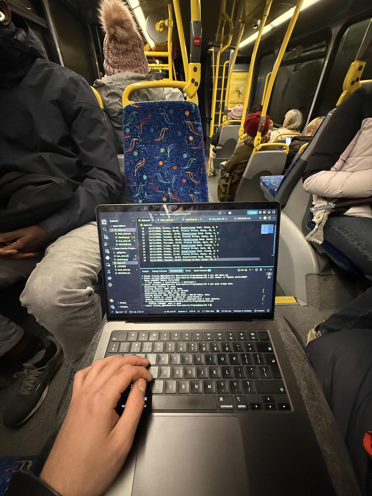
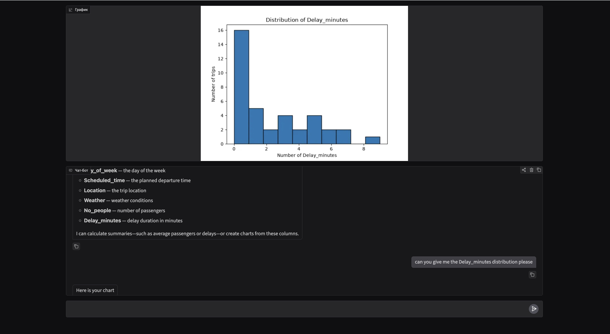

# Data Centric Programming Assignment 2026

## Data Dictionary

### Data-Centric-Programming-CA1

My dataset records buses (No37) punctuality. I take observations on 2 bus stops(Diswellstown Road, Prussia Street). The dataset represents whether the bus arrives on time, and if not, how many minutes it is late. The dataset also includes extra observation elements(like date, Day_of_week, Location, Weather, and No_people). Each row represents one bus trip.

The data was collected every time I took the bus, so the delay minutes refers to my real observations, instead relying on google maps info:



### Attribute Descriptions

| Attribute | Description |
| --- | --- |
| `Date` | Date of the observation (DD/MM/YYYY) |
| `Day_of_week` | Day of the week of the observation |
| `Scheduled_time` | Expected bus arrival time displayed in Google Maps |
| `Location` | Location of the observation |
| `Weather` | Weather conditions during the observation |
| `No_people` | Number of people counted on the bus |
| `Delay_minutes` | Minutes late, 0 means that was recorded no delay |

## Description of the project

This project is an AI-assisted analysis system designed to analyse and visualise data using libraries such as Matplotlib and pandas. The assistant is basically a large language model with tools that I designed myself for processing the given data.

It also has a chat interface that you can use to interact with the agent and see the visualisation results.

## Instructions for use

1. Run agent.py and open the local URL displayed in the terminal
2. Enter a question about the data or ask to visualise it in the chat, such as “What is the average number of passengers?” or “Show a pie chart of weather conditions”
3. Press **Enter** to submit your request
4. Read the calculated results in the chat or view the generated graph in the chart panel

You can continue asking questions using the same chat(the agent memories the chat history)

## How it works

### 1. Load the data

The application reads the bus-trip data from SQLite firstly:

```python
conn = sqlite3.connect("bus_data.db")
df = pd.read_sql_query("SELECT * FROM bus_trips", conn)
conn.close()
```

### 2. Connect the tools to the model

The tools are connected to the language model using bind_tools():

```python
llm_with_tools = llm.bind_tools(tools, reasoning_effort="none")
```

### 3. Process the user request

The system instructions, previous conversation and new message are sent and saved to the model:

```python
messages = (
    [{"role": "system", "content": SYSTEM_PROMPT}]
    + history
    + [{"role": "user", "content": message}]
)
response = llm_with_tools.invoke(messages)
```

### 4. Execute the selected tool

The model selects a suitable tool and supplies its arguments, such as the column names and runs it:

```python
for call in response.tool_calls:
    selected_tool = available_tools[call["name"]]
    result = selected_tool.invoke(call["args"])
```

Calculation tools use pandas to calculate statistics. Visualisation tools use Matplotlib to create figures

The example of the tool:

```python
@tool
def plot_boxPlot(column: list[str]):
    """Display a box plot showing the spread of numeric data"""
    column = column[0]
    fig = plt.figure()
    plt.boxplot(df[column])
    plt.title(f"Spread of {column}")
    plt.ylabel(column)
    plt.close(fig)
    return fig
```

### 5. Display the results

The application checks whether the result is a figure or a text result:

```python
if isinstance(result, Figure):
    chart = result
    reply += "Here is your chart\n"
else:
    reply += str(result) + "\n"
```

The chat function returns both outputs:

```python
return reply, chart
```

Gradio displays the reply in the conversation and sends the figure to a chart panel:

```python
with gr.Blocks() as app:
    chart_output = gr.Plot()
    gr.ChatInterface(
        fn=chat,
        additional_outputs=[chart_output],
    )
app.launch()
```


The interface image:



## Findings

Evening trips were busier than morning trips, averaging **40.69 passengers** and **8.29** in the morning.

Morning trips with more passengers tended to have longer delays

Rainy trips had higher passenger counts on average than sunny trips.

**Wednesdays** has the highest average passenger count: **27**

Among trips with fewer than 10 passengers bus came **on time**.

Overall, approximately **42% of the recorded trips were not delayed**

## List of files in the project

| File | Description |
| --- | --- |
| agent.py | The language model, handles tool calling and runs the Gradio chat interface |
| tools.py | Contains the data selection, calculation and visualisation tools |
| cleaning.py | Cleans the CSV data |
| load_data.py | Loads the data into the SQLite database from scv |
| data.csv | Contains the original bus-trip dataset |
| bus_data.db | Stores the bus-trip data in SQLite |
| README.md | the project description |
| images/ | Stores images used in the project documentation |
| .env | Stores the API key |
| .gitignore | Specifies files and folders excluded from Git tracking |
| LICENSE | Contains the project licence |

## What I am most proud of in the assignment and What I learned

I am most proud of connecting the language model to my own data analysis and visualisation tools.

I also enjoyed bringing pandas, Matplotlib, SQLite and Gradio together in one application. For example, the data was loaded from SQLite, processed using pandas and then used to create chart with Matplotlib. Gradio allowed me display the results through a chat interface

Getting everything to work was not always straightforward. I had to fix problems with the arguments passed to tools, their return value and how charts was displayed. These problems helped me understand the code better, especially the difference between the models selecting a tool and how does Python actually executing it

I was particularly happy when I could request a chart through the chat and see it appear in the interface. It made the project feel more useful in practice
